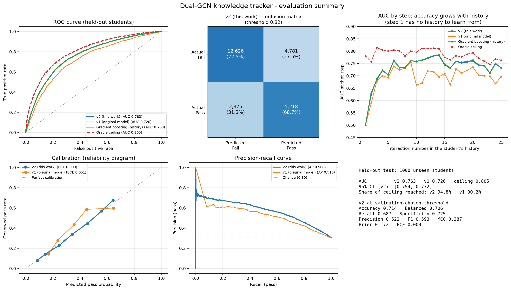
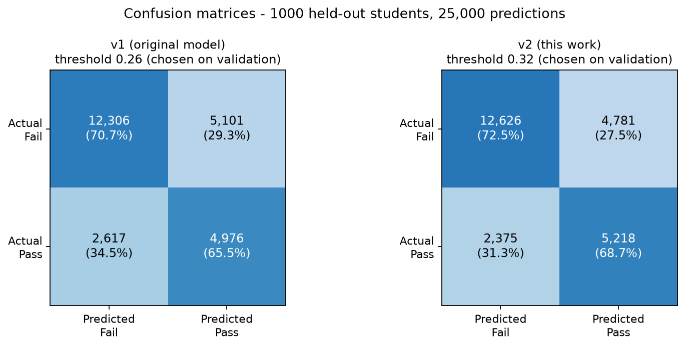
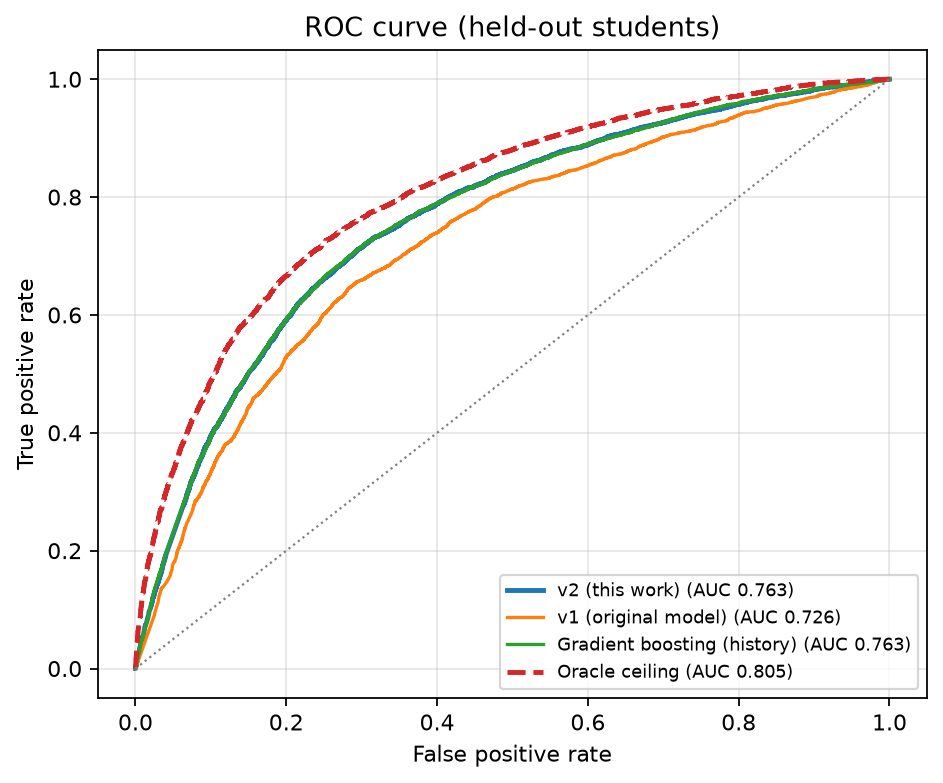
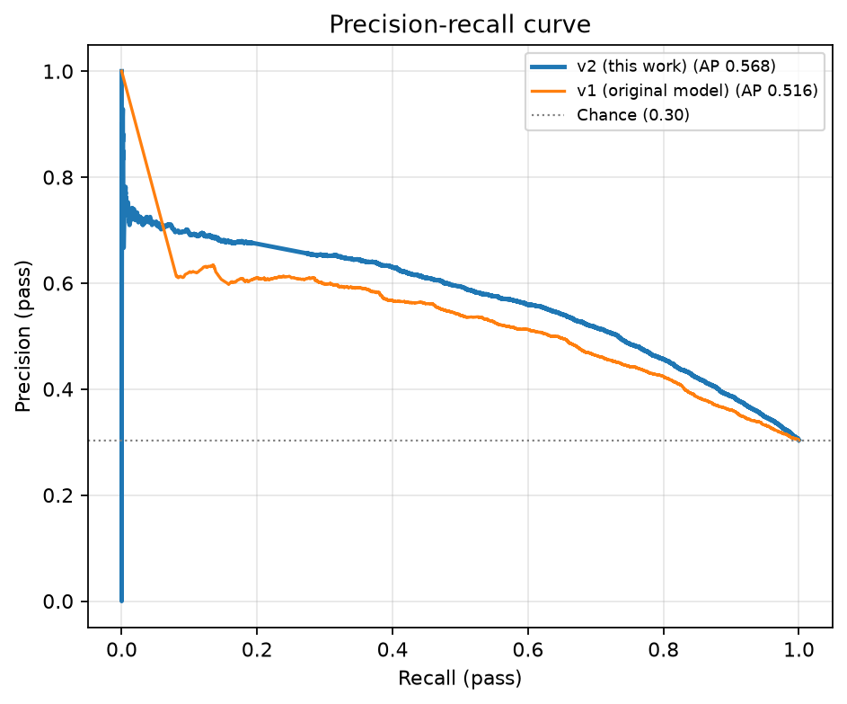
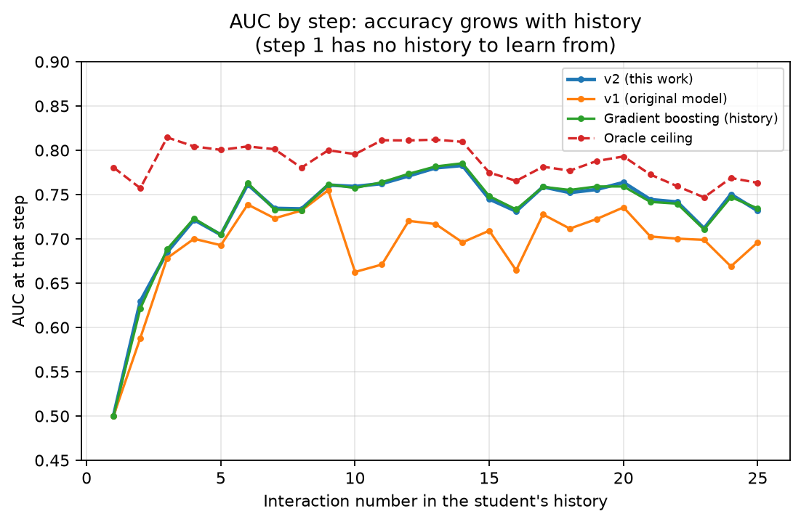
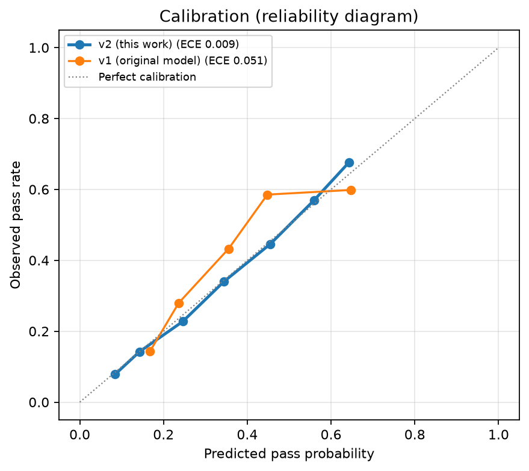
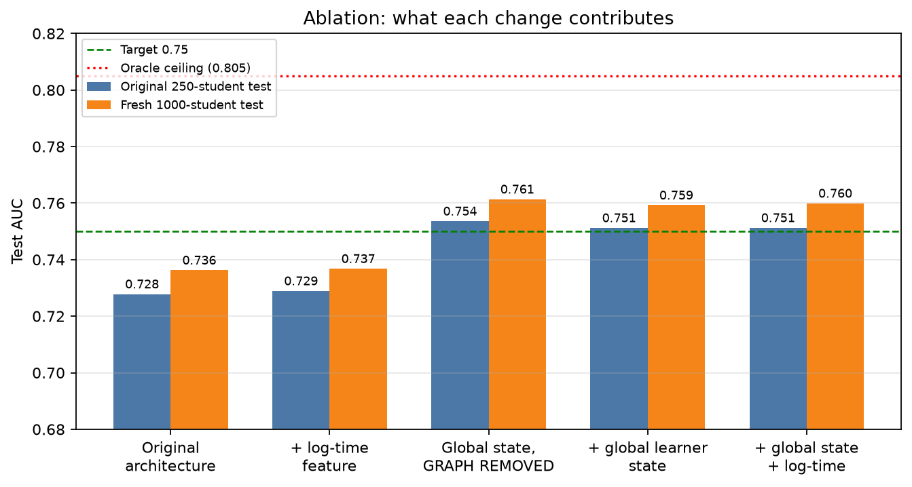
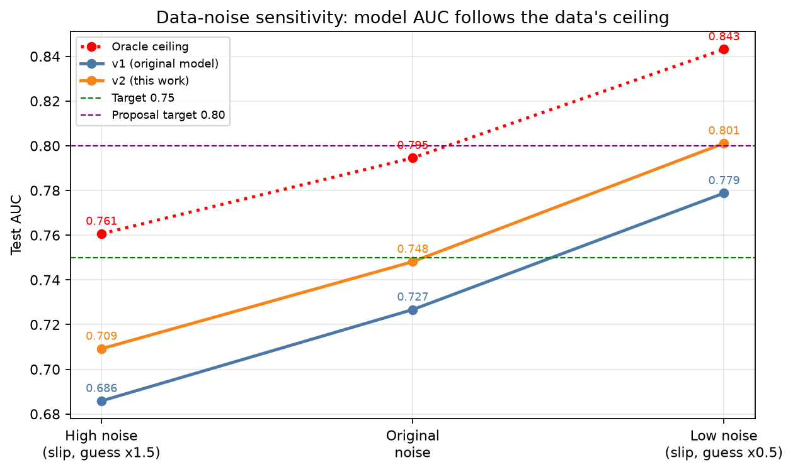

# Knowledge tracker - evaluation report

Generated by `experiments/report_tracker_v2.py` from saved predictions; nothing is hand-entered.

## Protocol

- Task: before each of a student's 25 interactions, predict whether they will pass it, from the earlier history only (no look-ahead).
- Training students: 4,000. Validation: 250 students (used only to pick the epoch, the variant and the decision threshold).
- Two held-out test sets, never used for any choice: the **original 250-student test split** (same students as the previously reported 0.7176) and a **fresh 1,000-student set** (new random seed) for tighter confidence intervals.
- Probabilities are calibrated before computing Brier/ECE/threshold metrics (the original model's class-weight offset is removed). The operating threshold is chosen on validation by Youden's J and applied unchanged to test.
- 95% confidence intervals resample whole students (1,000 bootstrap draws).
- **Oracle ceiling** = AUC of the simulator's true pass probabilities, which uses hidden information no real tracker can observe; it is the theoretical maximum on this data. The proposal's 0.80 target lies above it.

## Results - Fresh 1,000-student test set

| Model | AUC [95% CI] | PR-AUC | Accuracy | Balanced acc. | Precision | Recall | Specificity | F1 | MCC | Brier | ECE |
|---|---|---|---|---|---|---|---|---|---|---|---|
| Oracle ceiling | 0.805 [0.797, 0.813] | 0.657 | 0.741 | 0.737 | 0.557 | 0.725 | 0.749 | 0.630 | 0.445 | 0.1561 | 0.0063 |
| v2 (this work) | 0.763 [0.754, 0.772] | 0.568 | 0.714 | 0.706 | 0.522 | 0.687 | 0.725 | 0.593 | 0.387 | 0.1720 | 0.0091 |
| v1 (original model) | 0.726 [0.716, 0.735] | 0.516 | 0.691 | 0.681 | 0.494 | 0.655 | 0.707 | 0.563 | 0.340 | 0.1856 | 0.0509 |
| v1 as originally reported (thr 0.5, uncalibrated) | 0.726 [0.716, 0.735] | 0.516 | 0.704 | 0.676 | 0.511 | 0.603 | 0.748 | 0.553 | 0.337 | 0.2071 | 0.1543 |
| Gradient boosting (history) | 0.763 [0.754, 0.772] | 0.568 | 0.716 | 0.707 | 0.525 | 0.685 | 0.729 | 0.594 | 0.390 | 0.1718 | 0.0108 |
| Logistic regression (history) | 0.760 [0.751, 0.768] | 0.559 | 0.708 | 0.706 | 0.514 | 0.700 | 0.711 | 0.593 | 0.384 | 0.1733 | 0.0118 |
| Concept prior only | 0.614 [0.607, 0.621] | 0.420 | 0.624 | 0.581 | 0.399 | 0.473 | 0.689 | 0.433 | 0.155 | 0.2015 | 0.0042 |

v2 (this work) confusion matrix (counts): TN 12,626 | FP 4,781 | FN 2,375 | TP 5,218; cold-start AUC (steps 1-2) 0.583, steady-state AUC (steps 3-25) 0.754 (oracle 0.769 / 0.795).

## Results - Original 250-student test split

| Model | AUC [95% CI] | PR-AUC | Accuracy | Balanced acc. | Precision | Recall | Specificity | F1 | MCC | Brier | ECE |
|---|---|---|---|---|---|---|---|---|---|---|---|
| Oracle ceiling | 0.796 [0.778, 0.811] | 0.660 | 0.744 | 0.730 | 0.567 | 0.695 | 0.766 | 0.625 | 0.439 | 0.1587 | 0.0107 |
| v2 (this work) | 0.755 [0.736, 0.772] | 0.570 | 0.708 | 0.697 | 0.518 | 0.668 | 0.726 | 0.584 | 0.371 | 0.1743 | 0.0119 |
| v1 (original model) | 0.718 [0.697, 0.735] | 0.512 | 0.686 | 0.676 | 0.490 | 0.651 | 0.701 | 0.559 | 0.330 | 0.1877 | 0.0450 |
| v1 as originally reported (thr 0.5, uncalibrated) | 0.718 [0.697, 0.735] | 0.512 | 0.701 | 0.674 | 0.510 | 0.605 | 0.743 | 0.553 | 0.334 | 0.2087 | 0.1523 |
| Gradient boosting (history) | 0.756 [0.736, 0.773] | 0.572 | 0.711 | 0.699 | 0.522 | 0.669 | 0.729 | 0.586 | 0.376 | 0.1740 | 0.0137 |
| Logistic regression (history) | 0.753 [0.734, 0.770] | 0.558 | 0.703 | 0.700 | 0.511 | 0.695 | 0.706 | 0.589 | 0.375 | 0.1752 | 0.0130 |
| Concept prior only | 0.614 [0.598, 0.628] | 0.424 | 0.623 | 0.581 | 0.402 | 0.472 | 0.690 | 0.434 | 0.155 | 0.2023 | 0.0038 |

v2 (this work) confusion matrix (counts): TN 3,147 | FP 1,188 | FN 636 | TP 1,279; cold-start AUC (steps 1-2) 0.599, steady-state AUC (steps 3-25) 0.744 (oracle 0.772 / 0.784).

## Consistency across training seeds (test AUC)

| Run | Validation AUC | Original test | Fresh test |
|---|---|---|---|
| final_s0 | 0.7637 | 0.7544 | 0.7620 |
| final_s1 | 0.7643 | 0.7555 | 0.7630 |
| final_s2 | 0.7636 | 0.7543 | 0.7622 |
| **mean +/- std** | | 0.7547 +/- 0.0005 | 0.7624 +/- 0.0004 |

## Ablation (same data, same budget, single seed per row)

| Variant | Validation AUC | Original test AUC | Fresh test AUC |
|---|---|---|---|
| global_logtime | 0.7625 | 0.7513 | 0.7599 |
| global | 0.7618 | 0.7512 | 0.7593 |
| logtime | 0.7431 | 0.7289 | 0.7368 |
| global_nograph | 0.7622 | 0.7536 | 0.7614 |
| original | 0.7430 | 0.7278 | 0.7363 |

## Data-noise sensitivity study

Same simulator, only the slip and guess rates are scaled (these set the ceiling). Each level has its own 3,000 students (2,000 train / 500 val / 500 test). This is a sensitivity analysis on **different data**, reported separately from the headline results above.

| Noise level | Oracle ceiling | v1 architecture | v2 (this work) | v2 share of ceiling |
|---|---|---|---|---|
| High noise (slip, guess x1.5) | 0.761 | 0.686 | 0.709 | 93.2% |
| Original noise | 0.795 | 0.727 | 0.748 | 94.2% |
| Low noise (slip, guess x0.5) | 0.843 | 0.779 | 0.801 | 95.0% |

## Figures

