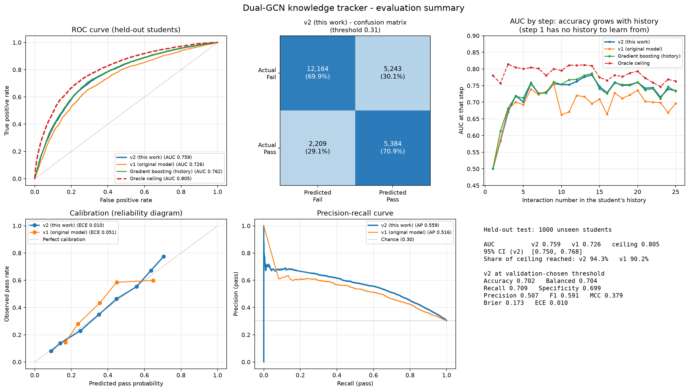
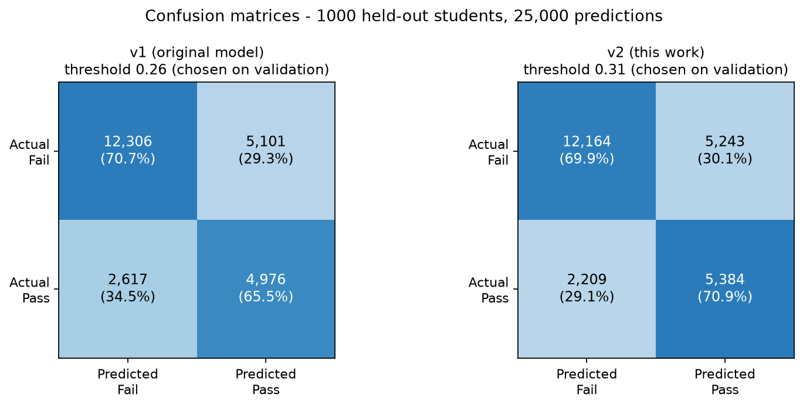
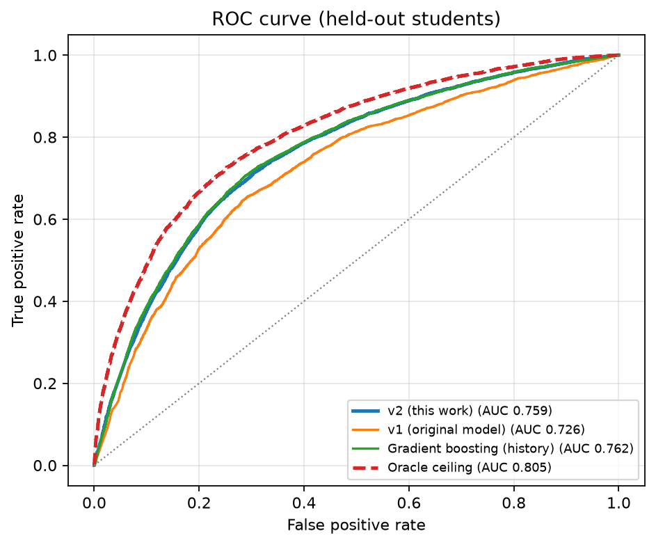
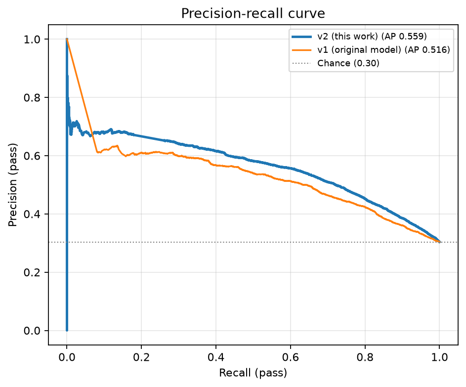
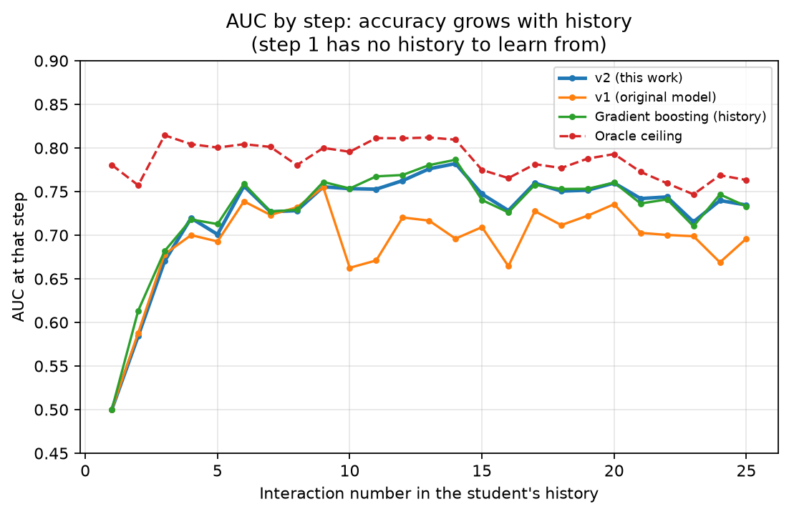
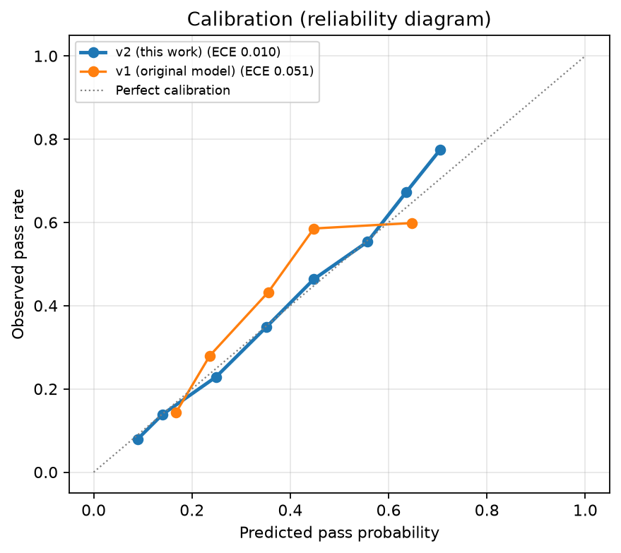
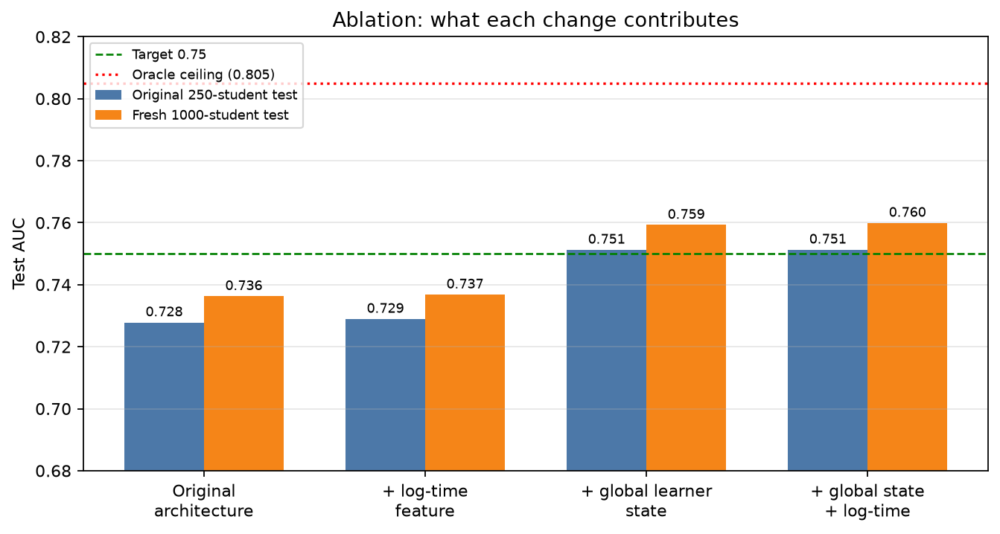

# Knowledge tracker - evaluation report

Generated by `experiments/report_tracker_v2.py` from saved predictions; nothing is hand-entered.

## Protocol

- Task: before each of a student's 25 interactions, predict whether they will pass it, from the earlier history only (no look-ahead).
- Training students: 2,000. Validation: 250 students (used only to pick the epoch, the variant and the decision threshold).
- Two held-out test sets, never used for any choice: the **original 250-student test split** (same students as the previously reported 0.7176) and a **fresh 1,000-student set** (new random seed) for tighter confidence intervals.
- Probabilities are calibrated before computing Brier/ECE/threshold metrics (the original model's class-weight offset is removed). The operating threshold is chosen on validation by Youden's J and applied unchanged to test.
- 95% confidence intervals resample whole students (1,000 bootstrap draws).
- **Oracle ceiling** = AUC of the simulator's true pass probabilities, which uses hidden information no real tracker can observe; it is the theoretical maximum on this data. The proposal's 0.80 target lies above it.

## Results - Fresh 1,000-student test set

| Model | AUC [95% CI] | PR-AUC | Accuracy | Balanced acc. | Precision | Recall | Specificity | F1 | MCC | Brier | ECE |
|---|---|---|---|---|---|---|---|---|---|---|---|
| Oracle ceiling | 0.805 [0.797, 0.813] | 0.657 | 0.741 | 0.737 | 0.557 | 0.725 | 0.749 | 0.630 | 0.445 | 0.1561 | 0.0063 |
| v2 (this work) | 0.759 [0.750, 0.768] | 0.559 | 0.702 | 0.704 | 0.507 | 0.709 | 0.699 | 0.591 | 0.379 | 0.1734 | 0.0095 |
| v1 (original model) | 0.726 [0.716, 0.735] | 0.516 | 0.691 | 0.681 | 0.494 | 0.655 | 0.707 | 0.563 | 0.340 | 0.1856 | 0.0509 |
| v1 as originally reported (thr 0.5, uncalibrated) | 0.726 [0.716, 0.735] | 0.516 | 0.704 | 0.676 | 0.511 | 0.603 | 0.748 | 0.553 | 0.337 | 0.2071 | 0.1543 |
| Gradient boosting (history) | 0.762 [0.752, 0.770] | 0.560 | 0.717 | 0.706 | 0.527 | 0.678 | 0.734 | 0.593 | 0.389 | 0.1725 | 0.0118 |
| Logistic regression (history) | 0.759 [0.750, 0.768] | 0.557 | 0.692 | 0.703 | 0.496 | 0.729 | 0.676 | 0.590 | 0.375 | 0.1734 | 0.0131 |
| Concept prior only | 0.613 [0.606, 0.620] | 0.420 | 0.639 | 0.581 | 0.410 | 0.432 | 0.729 | 0.421 | 0.159 | 0.2016 | 0.0092 |

v2 (this work) confusion matrix (counts): TN 12,164 | FP 5,243 | FN 2,209 | TP 5,384; cold-start AUC (steps 1-2) 0.572, steady-state AUC (steps 3-25) 0.750 (oracle 0.769 / 0.795).

## Results - Original 250-student test split

| Model | AUC [95% CI] | PR-AUC | Accuracy | Balanced acc. | Precision | Recall | Specificity | F1 | MCC | Brier | ECE |
|---|---|---|---|---|---|---|---|---|---|---|---|
| Oracle ceiling | 0.796 [0.778, 0.811] | 0.660 | 0.744 | 0.730 | 0.567 | 0.695 | 0.766 | 0.625 | 0.439 | 0.1587 | 0.0107 |
| v2 (this work) | 0.751 [0.732, 0.768] | 0.563 | 0.696 | 0.697 | 0.503 | 0.698 | 0.696 | 0.585 | 0.367 | 0.1758 | 0.0101 |
| v1 (original model) | 0.718 [0.697, 0.735] | 0.512 | 0.686 | 0.676 | 0.490 | 0.651 | 0.701 | 0.559 | 0.330 | 0.1877 | 0.0450 |
| v1 as originally reported (thr 0.5, uncalibrated) | 0.718 [0.697, 0.735] | 0.512 | 0.701 | 0.674 | 0.510 | 0.605 | 0.743 | 0.553 | 0.334 | 0.2087 | 0.1523 |
| Gradient boosting (history) | 0.754 [0.734, 0.771] | 0.569 | 0.715 | 0.700 | 0.528 | 0.659 | 0.740 | 0.586 | 0.379 | 0.1746 | 0.0138 |
| Logistic regression (history) | 0.753 [0.733, 0.769] | 0.556 | 0.686 | 0.697 | 0.491 | 0.726 | 0.668 | 0.586 | 0.365 | 0.1755 | 0.0140 |
| Concept prior only | 0.614 [0.600, 0.628] | 0.424 | 0.642 | 0.585 | 0.419 | 0.438 | 0.732 | 0.428 | 0.168 | 0.2024 | 0.0089 |

v2 (this work) confusion matrix (counts): TN 3,016 | FP 1,319 | FN 579 | TP 1,336; cold-start AUC (steps 1-2) 0.589, steady-state AUC (steps 3-25) 0.739 (oracle 0.772 / 0.784).

## Consistency across training seeds (test AUC)

| Run | Validation AUC | Original test | Fresh test |
|---|---|---|---|
| abl_global_s0 | 0.7618 | 0.7512 | 0.7593 |

## Ablation (same data, same budget, single seed per row)

| Variant | Validation AUC | Original test AUC | Fresh test AUC |
|---|---|---|---|
| global_logtime | 0.7625 | 0.7513 | 0.7599 |
| global | 0.7618 | 0.7512 | 0.7593 |
| logtime | 0.7431 | 0.7289 | 0.7368 |
| original | 0.7430 | 0.7278 | 0.7363 |

## Figures

